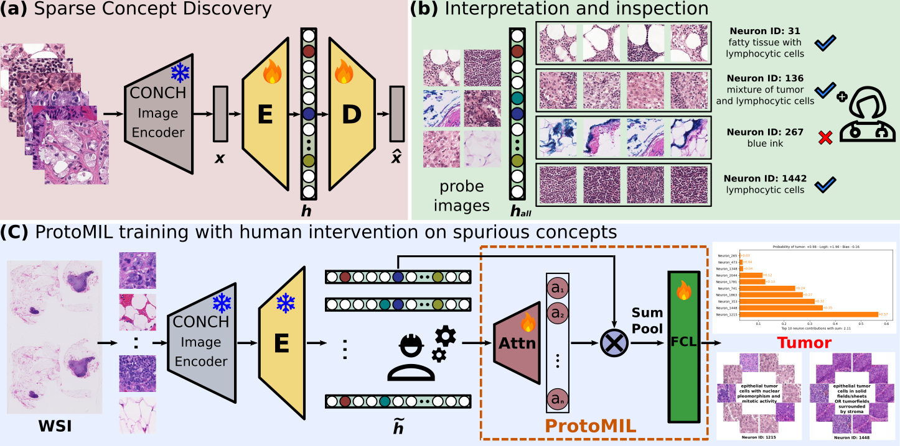

# ProtoMIL
Official implementation for MICCAI 2025 paper:
## Prototype-Based Multiple Instance Learning for Gigapixel Whole Slide Image Classification
[Arxiv Paper](https://arxiv.org/abs/2503.08384)

**Note**: For any questions regarding the paper and code, please contact Susu Sun (susu.sun@uni-tuebingen.de).


## ProtoMIL framework
The ProtoMIL approach consists of the following three stages.

<div style="displaystyle=block;align=center;"><p align="center" >
  
  </p>
</div>

(a) Sparse concept discovery:
- Image features *x* are extracted from Whole Slide Image (WSI) patches using the histopathology vision-language model CONCH.
- A sparse autoencoder (SAE) (**E**, **D**) is trained to reconstruct the image features from the latent embedding *h*.
- By enforcing dim (*h*) > dim (*x* ), the SAE yields a sparse and highly interpretable latent embedding *h*.

(b) Interpretation and inspection:
- The probing image set is constructed by randomly sampling 10K normal patches and 10K tumor patches from the downstream task training set.
- For each non-zero neuron, the 10 patches with the highest activation values h_i are selected to build a prototype.
- A pathologist examines the selected patches and maps the prototypes to corresponding histopathology concepts and identifies spurious concepts.

(c) ProtoMIL training with human intervention on spurious concepts:
- For WSI classification, image features are first projected onto human-interpretable concept activation vectors *h*.
- Inherent interpretable ProtoMIL is trained to generate predictions as linear combinations of input concepts, and provide self-explanations.
- Users can perform interventions by perturbing the concept activation vectors.

## Installation
```
conda env create -f environment.yml
conda activate protomil
```
## Datasets
We perform experiments on the **Camelyon16** and **PANDA** datasets. Please find these datasets on their official websites. Please download both the WSI and the corresponding label mask in order to extract normal patches and tumor patches to create the probing image set.
- **Camelyon16** (https://camelyon16.grand-challenge.org/Data/)
- **PANDA** (https://panda.grand-challenge.org/data/)
  
## Data preprocessing
To train SAE and ProtoMIL, we need to extract image features for WSIs, and save the WSI features as .pt file. For example, ```normal_001.pt```
(a) For this work, we used the pipeline from CLAM (https://github.com/mahmoodlab/CLAM) to create patches and extract features. 

You can also used the new whole-slide image processing toolkit Trident (https://github.com/mahmoodlab/TRIDENT). We used Histopathology-specific vision-language foundation model CONCH 1.0 for feature extraction.
When running Trident, you can specify this patch encoder by adding `--patch_encoder conch_v1` to the following command.
```bash
python run_batch_of_slides.py --task feat --wsi_dir ./wsis --job_dir ./trident_processed --patch_encoder conch_v1 --mag 20 --patch_size 256 
```
(b) When using Trident, the extracted WSI features are saved as ```.h5``` file, e.g. ```normal_001.h5```. You can convert the ```.h5``` file into ```.pt``` format by running the script below, 
making sure to update ```src_folders``` to point to your Trident output directories. Note that the features must be normalized with an L2 norm of 1.0, which is essential for training the SAE.
```bash
python scripts/prepare_sae_data.py
```

## Train Sparse autoencoder
We use the sparse autoencoder (SAE) implemented by (https://github.com/ai-safety-foundation/sparse_autoencoder) and reuse related code from (https://github.com/neuroexplicit-saar/discover-then-name)
We train SAE on the features from two datasets. 
Please change the ""sae_dataset" in ```data_dir_dict``` to your own data directory. Then run the following command to train SAE. 

```bash
python train_sae.py
```

## Create prototypes for neurons and perform interpretation
After the SAE is trained, we can create prototypes for each neuron in the latent space. The prototypes are created by selecting the top 10 patches with the highest activation values for each non-zero neuron.

(a) We need to first build the probing image set. For each dataset, we randomly sample 10K normal patches and 10K tumor patches from the training set to create the probing image set. 
```prepare_probing_imgs.py``` is the script for creating the probing set. Please change the ```dataset_dict``` to your own path to the WSIs and their masks, 
and set the ```task``` to "get_basic_info", "extract_patches_panda", "extract_patches_camelyon16" to create the probing image set for two datasets. You can find more details about the function in the script.
For reading the WSIs and masks, we use ASAP (https://computationalpathologygroup.github.io/ASAP/). 

```bash
python prepare_probing_imgs.py
```

(b) After the probing image set is created, we can create prototypes for each non-zero neuron. Using the script ```analyze_sae_space.py```

Please change the ```sae_dataset``` and ```probing_dataset``` to your own path.


## Project image features to concept space

## Train ProtoMIL

## Generate local and global explanations

